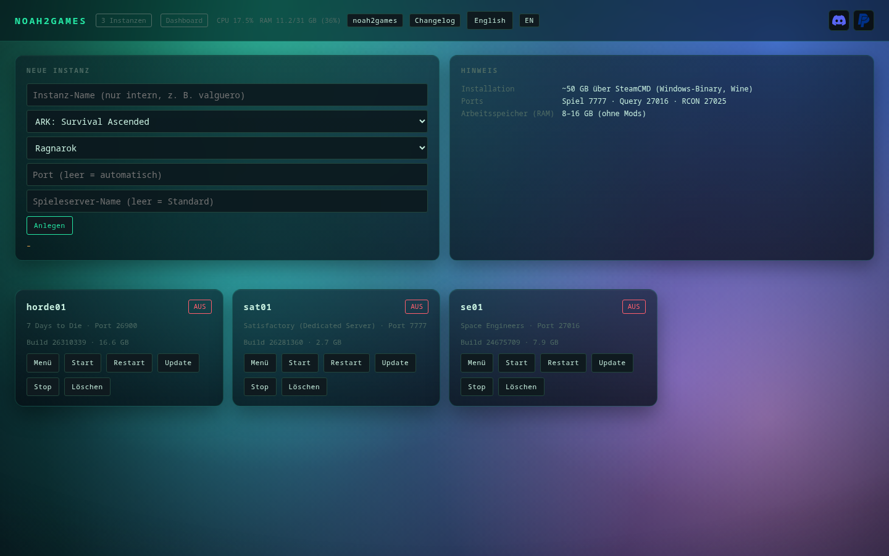
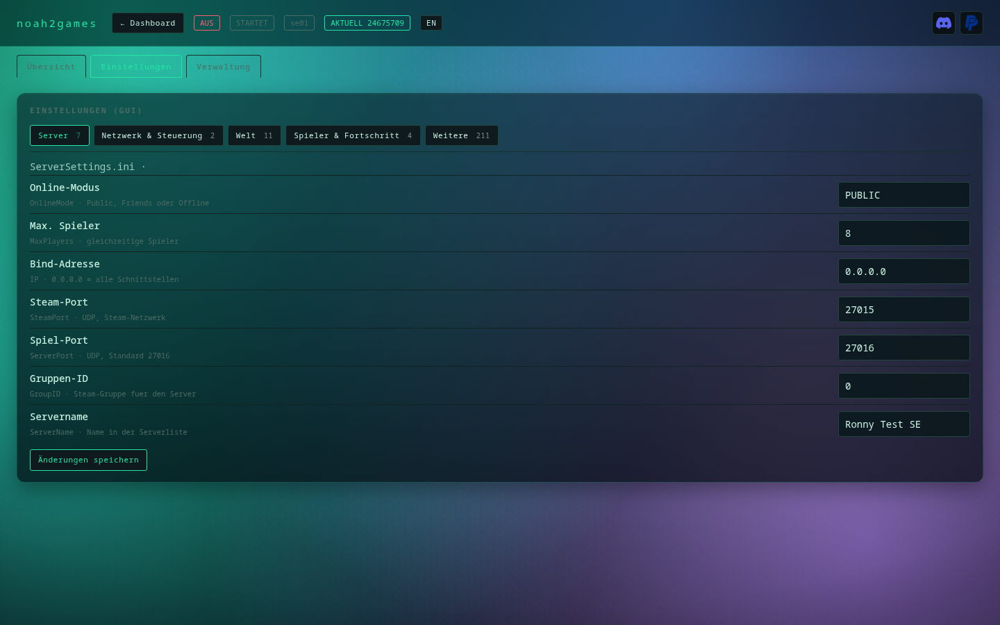
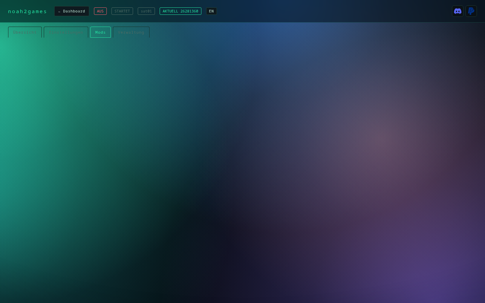
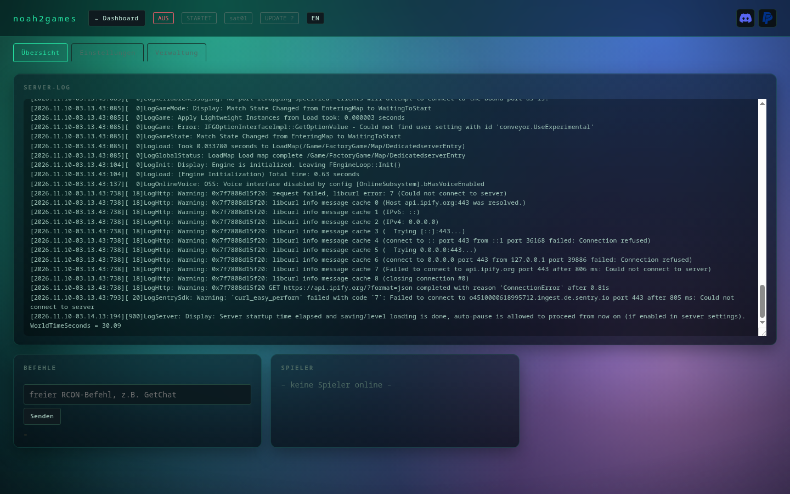
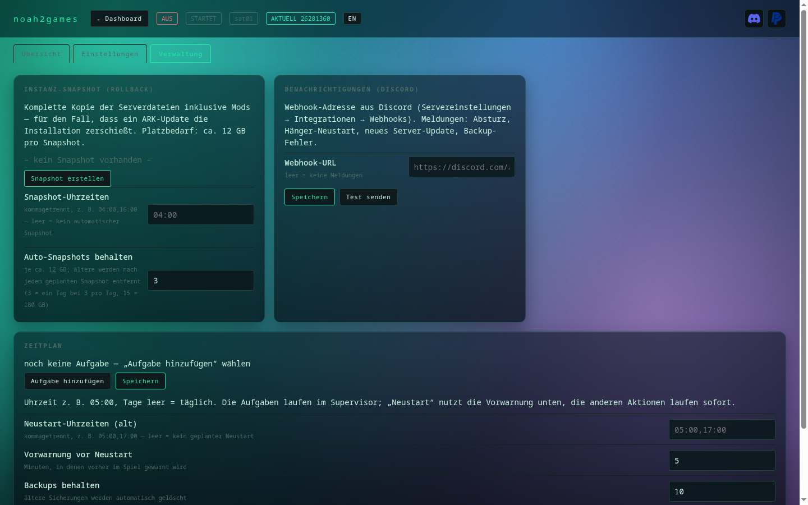

# noah2games — ARK: Survival Ascended Servermanager für Linux · Web-UI im Browser

[Deutsch](README.de.md) · [English](README.md) — der Installer fragt beim Start nach der Sprache, die Oberfläche lässt sich
jederzeit umschalten (Knopf oben rechts, `noah2games lang en` in der Konsole).

[](https://www.paypal.com/donate/?business=ronnyhase%40fn.de&item_name=noah2games%20Servermanager&currency_code=EUR)
[](https://discord.gg/ark-ase-asa-hilfe)

[](#installation)
[](#installation)
[](#installation)
[](#installation)
[](#installation)

**[Installation](#installation)** · [Deinstallation](#deinstallieren) · [Funktionen](docs/funktionen.md) · [Zugriff](docs/zugriff.md) · [Betrieb](docs/betrieb.md) · [Technik](docs/technik.md)

Ein eigener Servermanager für ARK-ASA-Dedicated-Server: Start, Stop, Updates, Mods, Backups,
Einstellungen und Spielerverwaltung über eine Weboberfläche.

> **Keine App für deinen PC — kein Windows- oder macOS-Programm.** noah2games läuft als Dienst auf dem
> Linux-Server und wird im **Browser** bedient: vom PC, Notebook, Tablet oder Handy, im Heimnetz oder
> über VPN. Auf dem Server installierst du es **einmal** (`install.sh`, `git clone`); danach gibt es
> nichts mehr herunterzuladen und kein Programm zu starten — nur die Adresse mit Token.

Reines Python (nur Standardbibliothek), SteamCMD für Installation und Updates, Wine für den
Serverprozess, RCON für alles, was der Server von außen anbietet.



## Weitere Spiele (Satisfactory, 7 Days to Die, Space Engineers)

noah2games kann neben ARK: Survival Ascended auch andere Dedicated Server verwalten. Der Kern
(Start/Stop, Updates, Backups, Zeitplan, Web-UI, Mehrinstanzen) ist spielunabhängig; ein
**Spielprofil** liefert nur, was das jeweilige Spiel braucht:

| Profil | Steam-App | Start | Steuerung |
|---|---|---|---|
| `ark` | 2430930 | `ArkAscendedServer.exe` unter Wine | Source-RCON |
| `satisfactory` | 1690800 | `FactoryServer.sh` (nativ) | HTTPS-API `/api/v1` (Bearer-Token) |
| `7d2d` | 294420 | `startserver.sh` (nativ) | Telnet (`TelnetPassword` in `serverconfig.xml`) |
| `spaceengineers` | 298740 | `DedicatedServer64/SpaceEngineersDedicated.exe` unter Wine | kein RCON — Start/Stop, XML-Config, Serverkonsole |

Instanz anlegen:

```bash
noah2games --name fabrik init --game satisfactory
noah2games --name horde  init --game 7d2d
noah2games --name werft  init --game spaceengineers
noah2games --name fabrik start
```

Im Web-UI nimmt `POST /api/instances` zusätzlich den Parameter `game` an. Ports: Satisfactory
braucht drei (Spiel `-Port`, `-QueryPort`, `-BeaconPort`), 7 Days to Die Spiel-, Query- und
Telnet-Port. Die Instanzverzeichnisse liegen unter `~/noah2games-instances/<name>`.

**Space Engineers** ist der einzige Kandidat ohne Linux-Server: SteamCMD liefert nur die
Windows-.exe. noah2games legt deshalb beim ersten Installieren ein **gemeinsames Wine-Prefix**
(`~/.noah2games-wine-se`) an und installiert dort `dotnet48` und `vcrun2019` (einmalig, 10–20 min).
Ohne diese Laufzeit bricht der Start mit einer klaren Meldung ab statt still zu scheitern.
Konfiguriert wird über `SpaceEngineers-Dedicated.cfg` (über 200 Optionen), die Vorlage bringt
noah2games mit — Space Engineers legt sie nicht selbst an.

## Einblicke

| | |
|:--:|:--:|
|  |  |
|  |  |

Mehr dazu: [docs/funktionen.md](docs/funktionen.md)

## Installation

```bash
git clone https://github.com/Ronny-H-79/Noah2Games.git noah2games   # einmalig
cd noah2games
./install.sh --check     # prüfen, was fehlt (ändert nichts)
./install.sh             # installieren
noah2games wizard              # Instanz anlegen, Server laden, Dienst einrichten
```

**Voraussetzungen:** Linux, Python ≥ 3.10, Wine, `curl` und `tar`. Fehlende Pakete fragt der Installer
und installiert sie auf Wunsch (`pacman`, `apt`, `dnf`, `zypper`). SteamCMD lädt er selbst nach,
root-Rechte braucht nur das Nachinstallieren von Wine.

**Wo es getestet ist** — Stand 8. November 2026, jeweils mit laufendem ARK-ASA-Server:

| System | Version | Umgebung |
|---|---|---|
| Ubuntu LTS | 24.04.5 | Python 3.12.3, Wine 9.0 |
| Arch Linux (CachyOS) | aktuell | Python 3.14.9, Wine 11.21 |

Debian, Fedora und openSUSE unterstützt der Installer ebenfalls (`apt`, `dnf`, `zypper`), dort ist
noah2games aber noch nicht durchgetestet — Rückmeldung willkommen. Nötig ist 64-Bit-Wine (für den
Windows-Server von ARK); ältere Wine-Stände unter 8.0 sind nicht getestet.

Prüfen, was die eigene Kiste hat:

```bash
. /etc/os-release && echo "$PRETTY_NAME"; python3 --version; wine --version
```

Der Installer stellt nacheinander:

- **Sprache** (Deutsch/Englisch)
- ob fehlende Pakete (**Wine**, iproute2) nachinstalliert werden sollen
- **wie die Oberfläche erreichbar sein soll:**
  **Tunnel** — nur client-seitig über SSH,
  **Domain** — öffentlich mit HTTPS (wird gleich mitgespeichert),
  **IP** — direkt über IP und Port (HTTP, Port in der Firewall freigeben)
- **nur bei „Domain"**: ob die Web-Oberfläche dauerhaft laufen soll (`noah2games-web.service`) — als root ein
  **Systemdienst** in `/etc/systemd/system` (startet beim Booten, kein Login und kein `linger` nötig),
  als normaler Benutzer ein User-Dienst in `~/.config/systemd/user`

Bei **„Tunnel"** entfällt die letzte Frage: dafür braucht es keinen Dauerdienst, die Oberfläche wird
mit `noah2games web` gestartet, wenn du sie brauchst.

Am Ende steht genau der Befehl, der zu deiner Wahl passt: der SSH-Tunnel mit deinem Benutzer und der
**IP des Servers** (nicht dem Hostnamen — der ist von außen oft nicht auflösbar), oder
`sudo noah2games proxy --write --cert`, das die gespeicherte Domain automatisch verwendet.
`--web` / `--no-web` überspringt die Dienst-Frage.

> **Sicherheit:** Die Oberfläche ist eine Administrationskonsole — wer den Token hat, kann alles
> steuern. Modus `[3]` (direkt über IP) ist **unverschlüsselt**, der Token ist dort mitlesbar. Nimm
> `[1]` (SSH-Tunnel) oder `[2]` (HTTPS). Details: [docs/zugriff.md](docs/zugriff.md#sicherheit--was-der-token-bedeutet)

### Wenn die Installation hakt

| Meldung | Ursache | Lösung |
|---|---|---|
| `fatal: destination path 'noah2games' already exists` | der Ordner liegt schon da | `cd noah2games && git pull` statt erneut klonen |
| `./install.sh: No such file or directory` **nach** `cd noah2games` | du stehst im Paketordner `noah2games/noah2games` — dort liegen nur `.py`-Dateien | `cd ..` — `install.sh` liegt eine Ebene höher, im Projektordner |
| `noah2games: command not found` | `~/.local/bin` ist nicht im `PATH` | als root legt der Installer `/usr/local/bin/noah2games` an; sonst `export PATH="$HOME/.local/bin:$PATH"` und neue Shell öffnen |

**Eine Falle bei Namensgleichheit:** im Projektordner heißt der Python-Teil ebenfalls `noah2games`.
`cd noah2games` führt dich also ein zweites Mal hinein — dort liegen `cli.py`, `i18n.py` und Co., aber kein
`install.sh`. Merksatz: der richtige Ordner ist der mit `install.sh`, `README.md` und `docs/`.

Als **root** auf einem Server: alle Befehle in einer Sitzung hintereinander ausführen, sonst landet
man schnell im falschen Verzeichnis. Und für `systemctl --user` (Autostart) einmalig
`loginctl enable-linger root` — sonst startet der Dienst erst beim Login.

Details, Voraussetzungen und Deinstallation: [INSTALL.md](INSTALL.de.md)

## Deinstallieren

**Nur das Programm** (Instanzen, Backups und Einstellungen bleiben):

```bash
./install.sh --uninstall
```

Das beendet und entfernt auch die systemd-Dienste (`noah2games-web`, `noah2games-*`), damit nach dem Löschen
kein Dienst mehr ins Leere zeigt. Ist der Quellordner schon weg, reicht von Hand:

```bash
systemctl --user disable --now noah2games-web.service noah2games-test.service
rm -f ~/.config/systemd/user/noah2games-*.service ~/.local/bin/noah2games
rm -rf ~/.local/share/noah2games
```

**Alles weg** — zusätzlich Konfiguration, Token, Sicherungen und Serverdaten (zusammen etwa 24 GB):

```bash
rm -rf ~/.config/noah2games          # Instanzen, Token, Mod-Cache
rm -rf ~/noah2games-backups          # Welt-Backups
rm -rf ~/noah2games-snapshots        # Instanz-Snapshots
rm -rf ~/arkserver             # die Serverdateien (12 GB)
rm -rf ~/.wine-arkserver       # Wine-Prefix
```

Der letzte Schritt ist der einzige, der wirklich unwiederbringlich ist: Welt und Configs liegen in
`~/noah2games-backups` — wer die behält, kann später alles wieder herstellen.

## Mehr

| Thema | Datei |
|---|---|
| **Funktionen** — Übersicht, Screenshots, Mod-Suche, Discord-Meldungen | [docs/funktionen.md](docs/funktionen.md) |
| **Zugriff** — SSH-Tunnel, LAN, HTTPS per nginx, Token | [docs/zugriff.md](docs/zugriff.md) |
| **Betrieb** — Selbst-Update, Changelog, Sprache | [docs/betrieb.md](docs/betrieb.md) |
| **Technik** — Aufbau, Konsole, Stop-Reihenfolge, Interna | [docs/technik.md](docs/technik.md) |

Was sich zwischen Versionen geändert hat: [CHANGELOG.md](CHANGELOG.md) ·
Installationsdetails: [INSTALL.md](INSTALL.de.md)

## Hilfe

Fragen, Probleme oder einfach andere Serverbetreiber: die Community
**[Ark-ASA-ASE-Hilfe](https://discord.gg/ark-ase-asa-hilfe)** auf Discord hilft bei Einstellungen,
Mods und Startproblemen. Dort bekommst du auch Rueckmeldung zu noah2games.

## Lizenz

**Kostenlos nutzbar, alle Rechte beim Autor.** Herunterladen, installieren und auf eigenen
Servern betreiben ist frei — auch für eine Community. Weitergabe, Veränderung, Verkauf oder
das Anbieten als Download/Dienst brauchen eine schriftliche Zustimmung.
Details: [LICENSE](LICENSE).

© 2026 Ronny H.
