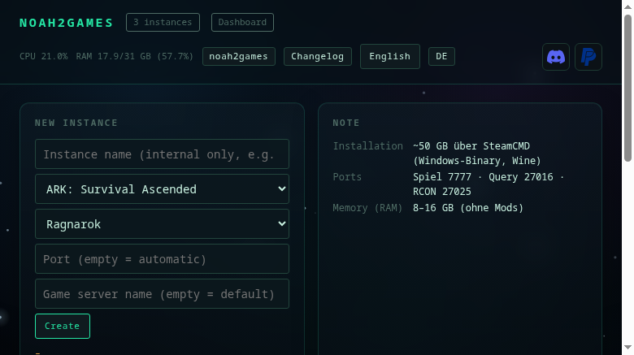
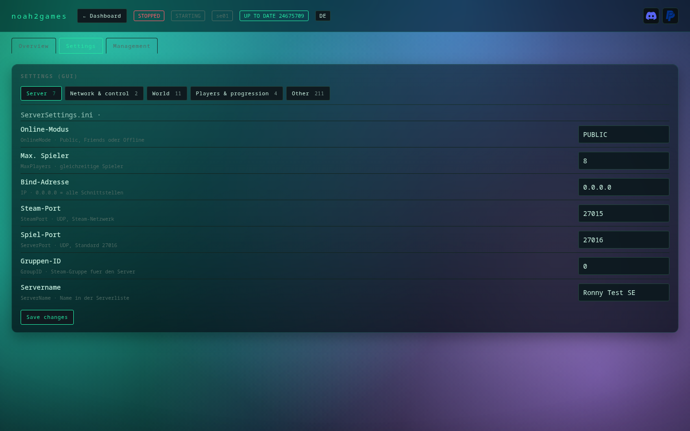
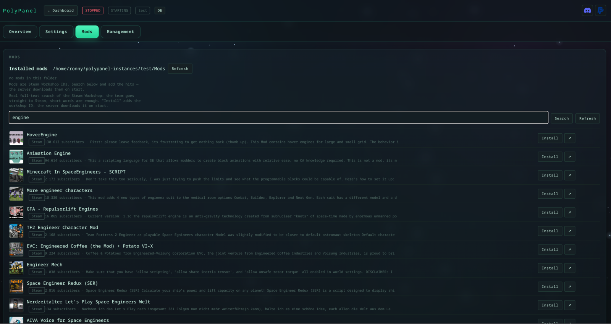
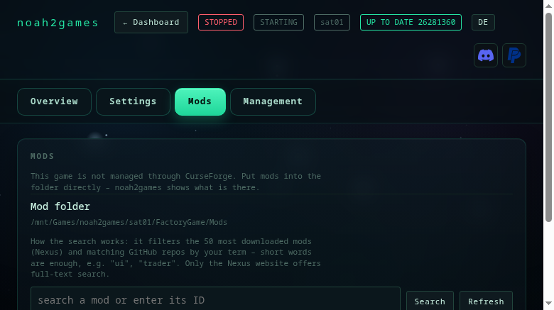
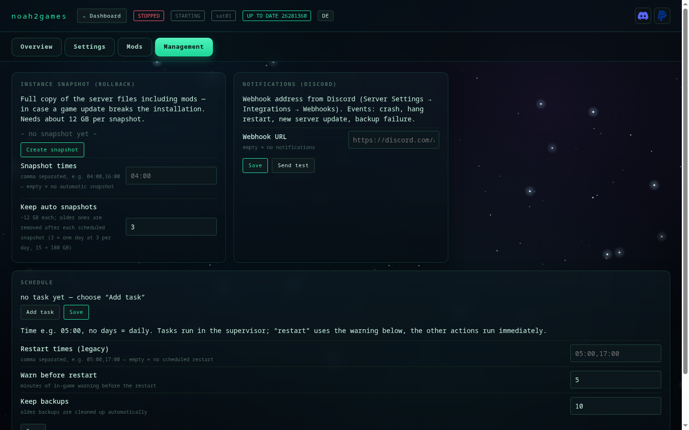

# PolyPanel — multigame server manager for Linux · web UI in the browser

ARK: Survival Ascended · ARK: Survival Evolved · Satisfactory · 7 Days to Die · Space Engineers — one manager, one web UI.

English · [Deutsch](README.de.md) — the installer asks for the language up front, and the UI can switch
any time (button in the top right, `polypanel lang en` on the console).

[](https://www.paypal.com/donate/?business=ronnyhase%40fn.de&item_name=PolyPanel%20Servermanager&currency_code=EUR)
[](https://discord.gg/ark-ase-asa-hilfe)
[](LICENSE)

[](#installation)
[](#installation)
[](#installation)
[](#installation)
[](#installation)

**[Installation](#installation)** · [Uninstall](#uninstall) · [Features](docs/funktionen.md) · [Access](docs/zugriff.md)

Your own server manager for ARK ASA dedicated servers: start, stop, updates, mods, backups, settings
and player management through a web interface.

> **Not an app for your PC — no Windows or macOS program.** polypanel runs as a service on the Linux
> server and is used in a **browser**: from your PC, laptop, tablet or phone, on your LAN or over VPN.
> You install it on the server **once** (`git clone`, `install.sh`); after that there is nothing to
> download and no program to launch — just the address with a token.

Plain Python (standard library only), SteamCMD for install and updates, Wine for the server process,
RCON for everything the server exposes.



## More games (ARK: Survival Evolved, Satisfactory, 7 Days to Die, Space Engineers)

polypanel manages other dedicated servers besides ARK: Survival Ascended. The core (start/stop,
updates, backups, schedules, web UI, multi-instance) is game-agnostic; a **game profile** only
provides what the game needs:

| Profile | Steam app | Launch | Control |
|---|---|---|---|
| `ark` | 2430930 | `ArkAscendedServer.exe` under Wine | Source RCON |
| `arkse` | 376030 | `ShooterGame/Binaries/Linux/ShooterGameServer` (native) | Source RCON (`ServerAdminPassword`) |
| `satisfactory` | 1690800 | `FactoryServer.sh` (native) | HTTPS API `/api/v1` (bearer token) |
| `7d2d` | 294420 | `startserver.sh` (native) | Telnet (`TelnetPassword` in `serverconfig.xml`) |
| `spaceengineers` | 298740 | `DedicatedServer64/SpaceEngineersDedicated.exe` under Wine | no RCON — start/stop, XML config, server console |

Create an instance:

```bash
polypanel --name island  init --game arkse --map Ragnarok
polypanel --name factory init --game satisfactory
polypanel --name horde   init --game 7d2d
polypanel --name yard    init --game spaceengineers
polypanel --name factory start
```

**ARK: Survival Evolved** is the older ARK generation and needs no Wine: SteamCMD ships a Linux
server. Configuration lives in `ShooterGame/Saved/Config/LinuxServer/` (`GameUserSettings.ini` and
`Game.ini`), the manager writes ports, name, admin password and workshop mods there, and the map
plus cluster arguments go into the launch line. Mods are Steam Workshop IDs, searched directly in
the workshop from the UI and loaded on start (`-automanagedmods`);
the settings tab reads **every** property from both INI files — 262 values, all with German labels.

The web UI accepts the extra `game` parameter on `POST /api/instances`. Ports: Satisfactory needs
three (`-Port`, `-QueryPort`, `-BeaconPort`), 7 Days to Die game, query and telnet ports. Instance
directories live in `~/polypanel-instances/<name>`.

## Screenshots

| | |
|:--:|:--:|
|  |  |
|  |  |

## Installation

```bash
git clone https://github.com/Ronny-H-79/PolyPanel.git polypanel   # once
cd polypanel
./install.sh --check     # check what is missing (changes nothing)
./install.sh             # install
polypanel web           # start the web UI - the address with token is printed
```

Instances are created **in the browser**: open the address the command prints, enter a name, pick the
game and map and press **Anlegen / Create** — the card then offers **Install** (SteamCMD, then start).
No terminal is needed after the first command.

**Console only, optional:** `polypanel wizard` is the terminal alternative to the browser — it asks
for name, map, port and session name, downloads the server files and sets up the systemd service. It
needs an interactive shell and is **not** required: everything the wizard does is also in the web UI.
`./install.sh --wizard` runs it directly after installing.

**Requirements:** Linux, Python ≥ 3.10, Wine, `curl` and `tar`. Missing packages are offered by the
installer (`pacman`, `apt`, `dnf`, `zypper`). SteamCMD is downloaded automatically; root is only needed
to install Wine.

**Where it is tested** — as of 8 November 2026, each with a running ARK ASA server:

| System | Version | Environment |
|---|---|---|
| Ubuntu LTS | 24.04.5 | Python 3.12.3, Wine 9.0 |
| Arch Linux (CachyOS) | current | Python 3.14.9, Wine 11.21 |

Debian, Fedora and openSUSE are supported by the installer as well (`apt`, `dnf`, `zypper`), but PolyPanel
has not been tested there yet — feedback welcome. 64-bit Wine is required (the ARK server is a Windows
build); Wine older than 8.0 is untested.

Check your own box:

```bash
. /etc/os-release && echo "$PRETTY_NAME"; python3 --version; wine --version
```

The installer asks, in order:

- **language** (German/English)
- whether missing packages (**Wine**, iproute2) should be installed
- **how the UI should be reachable:**
  **Tunnel** — client-side only over SSH,
  **Domain** — public with HTTPS (stored for later),
  **IP** — directly via IP and port (HTTP, open the port in your firewall)
- **only for "Domain"**: whether the UI should run permanently (`polypanel-web.service`) — as root a
  **system service** in `/etc/systemd/system` (starts at boot, no login or `linger` needed), as a normal
  user a user service in `~/.config/systemd/user`

With **"Tunnel"** the last question is skipped: no long-running service is needed, the UI starts with
`polypanel web` when you want it.

At the end you get the command that matches your choice: the SSH tunnel with your user and the
**server IP** (not the hostname — often not resolvable from outside), or
`sudo polypanel proxy --write --cert`, which uses the stored domain.
`--web` / `--no-web` skips the service question.

> **Security:** the UI is an admin console — whoever has the token controls everything. Mode `[3]`
> (direct via IP) is **unencrypted** and the token can be read on the wire. Use `[1]` (SSH tunnel) or
> `[2]` (HTTPS). Details: [docs/zugriff.md](docs/zugriff.md).

### When the install gets stuck

| Message | Cause | Fix |
|---|---|---|
| `fatal: destination path 'PolyPanel' already exists` | the folder is already there | `cd polypanel && git pull` instead of cloning again |
| `./install.sh: No such file or directory` **after** `cd polypanel/polypanel` | you are in the package folder `PolyPanel/PolyPanel` — only `.py` files live there | `cd ..` — `install.sh` is one level up |
| `PolyPanel: command not found` | `~/.local/bin` is not in `PATH` | as root the installer links `/usr/local/bin/PolyPanel`; otherwise `export PATH="$HOME/.local/bin:$PATH"` and open a new shell |

Details, requirements and uninstall: [INSTALL.md](INSTALL.md)

## Uninstall

**The program only** (instances, backups and settings stay):

```bash
./install.sh --uninstall
```

This also stops and removes the systemd units (`polypanel-web`, `polypanel-*`) so nothing points at a missing
file afterwards. If the source folder is already gone:

```bash
systemctl --user disable --now polypanel-web.service polypanel-test.service
rm -f ~/.config/systemd/user/polypanel-*.service ~/.local/bin/PolyPanel
rm -rf ~/.local/share/PolyPanel
```

**Everything** — additionally config, token, backups and server files (about 24 GB):

```bash
rm -rf ~/.config/polypanel          # instances, token, mod cache
rm -rf ~/polypanel-backups          # world backups
rm -rf ~/polypanel-snapshots        # instance snapshots
rm -rf ~/arkserver             # the server files (12 GB)
rm -rf ~/.wine-arkserver       # Wine prefix
```

Only the last step is irreversible: worlds and configs live in `~/polypanel-backups` — keep those and you can
restore everything later.

## More

| Topic | File |
|---|---|
| **Features** — overview, screenshots, mod search, Discord notifications | [docs/funktionen.md](docs/funktionen.md) |
| **Access** — SSH tunnel, LAN, HTTPS via nginx, token | [docs/zugriff.md](docs/zugriff.md) |
| **Operation** — self-update, changelog, language | [docs/betrieb.md](docs/betrieb.md) |
| **Internals** — structure, console, stop order | [docs/technik.md](docs/technik.md) |

What changed between versions: [CHANGELOG.en.md](CHANGELOG.en.md) ·
Install details: [INSTALL.md](INSTALL.md)

## Help

Questions, problems or just other server admins: the
**[Ark-ASA-ASE-Hilfe](https://discord.gg/ark-ase-asa-hilfe)** community on Discord helps with settings,
mods and start-up problems. That is also the place for feedback on PolyPanel.

## Licence

**Free to use, all rights reserved.** Downloading, installing and running it on your own servers is free
of charge — including for a community. Redistribution, modification, selling it or offering it as a
download/service requires written permission. Details: [LICENSE](LICENSE).

© 2026 Ronny H.
