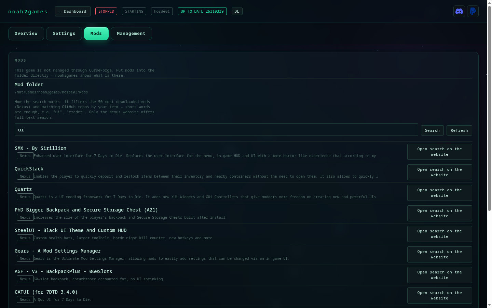

# Betrieb

noah2games aktuell halten, Sprache umstellen.

[← zurück zum README](../README.de.md) · [English](betrieb.md)

## noah2games aktuell halten

Was sich zwischen den Versionen geändert hat, steht in [CHANGELOG.md](../CHANGELOG.md) — und beim
Update-Klick zeigt der Dialog die Änderungen der neuen Version direkt an.


Oben rechts steht die Version (`v0.2.3`). Liegt auf GitHub eine neuere, wird der Knopf farbig und
zeigt beide Stände: **`v0.2.2 → 0.2.3`**. Ein Klick lädt das neue Paket, ersetzt nur das
Programmverzeichnis und startet den Web-Dienst neu — Instanzen, Backups und Einstellungen bleiben
unberührt. Der vorherige Stand bleibt als `noah2games.bak-<zeitstempel>` daneben liegen.

Auf der Konsole:

```bash
noah2games version        # installiert + verfügbar
noah2games self-update    # einspielen (Dienst wird neu gestartet)
```

Geprüft wird über die GitHub-API (Version aus `noah2games/__init__.py`). Kein git nötig, auch eine
Installation aus einem Archiv lässt sich so aktualisieren.

**Ältere Installationen** (vor 0.2.1) kennen `self-update` noch nicht — dort einmalig von Hand:

```bash
cd ~/noah2games && git pull && ./install.sh
```

Danach steht `noah2games self-update` zur Verfügung.

## Sprache

| | |
|---|---|
| **Beim Installieren** | `./install.sh` fragt „Sprache / Language" — oder direkt `./install.sh --lang en` |
| **Später wechseln** | `noah2games lang en` / `noah2games lang de` (schreibt `~/.config/noah2games/settings.json`) |
| **In der Weboberfläche** | Knopf `EN` / `DE` oben rechts, Seite lädt neu |

Alle Beschriftungen, Formularfelder, Befehlsschaltflächen, Rückfragen und Meldungen liegen in
`noah2games/i18n.py` (Deutsch und Englisch). Neue Texte brauchen nur einen weiteren Eintrag im Katalog.



---

© 2026 Ronny H. · Kostenlos nutzbar, alle Rechte beim Autor — [Lizenz](../LICENSE)
