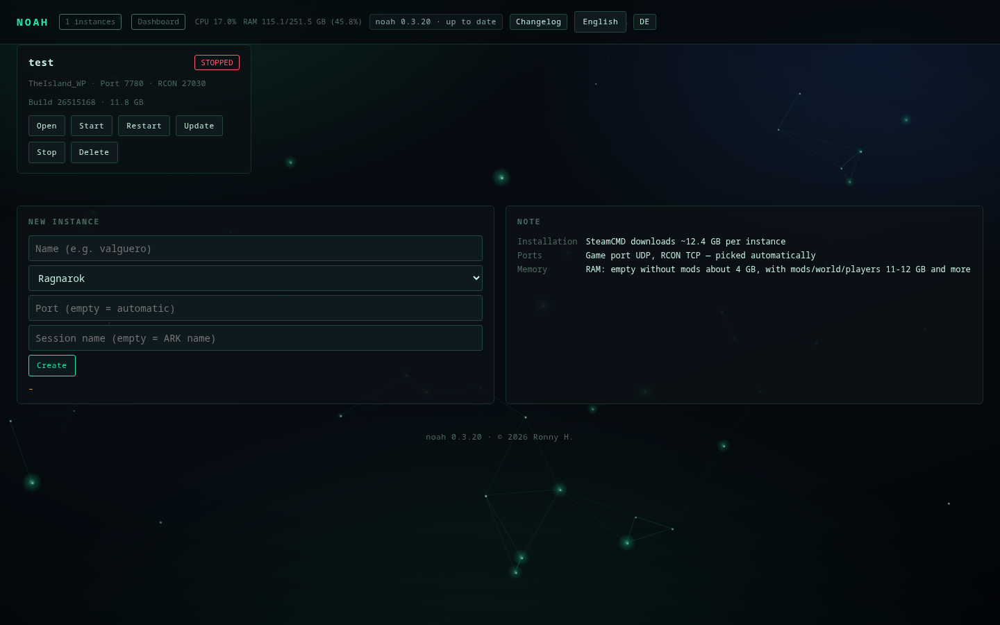

# Operation

Keeping noah2games up to date, switching the language.

[← back to the README](../README.md) · [Deutsch](betrieb.de.md)

## Keeping noah2games up to date

What changed between versions is in [CHANGELOG.en.md](../CHANGELOG.en.md) — and when you click update the
dialog shows the changes of the new version right there.

The top right shows the version. If GitHub has a newer one, the button turns coloured and shows both
states: **`v0.3.16 → 0.3.17`**. One click downloads the new package, replaces only the program directory
and restarts the web service — instances, backups and settings stay untouched. The previous state remains
next to it as `noah2games.bak-<timestamp>`.

On the console:

```bash
noah2games version        # installed + available
noah2games self-update    # apply (service is restarted)
```

The check goes through the GitHub API (version from `noah2games/__init__.py`). No git needed, so an installation
from an archive can update itself too.

## Language

| | |
|---|---|
| **At install time** | `./install.sh` asks "Sprache / Language" — or directly `./install.sh --lang en` |
| **Later** | `noah2games lang en` / `noah2games lang de` (writes `~/.config/noah2games/settings.json`) |
| **In the UI** | button `EN` / `DE` in the top right, the page reloads |

Every label, form field, command button, prompt and message lives in `noah2games/i18n.py` (German and English).
New text only needs one more entry in the catalogue.


