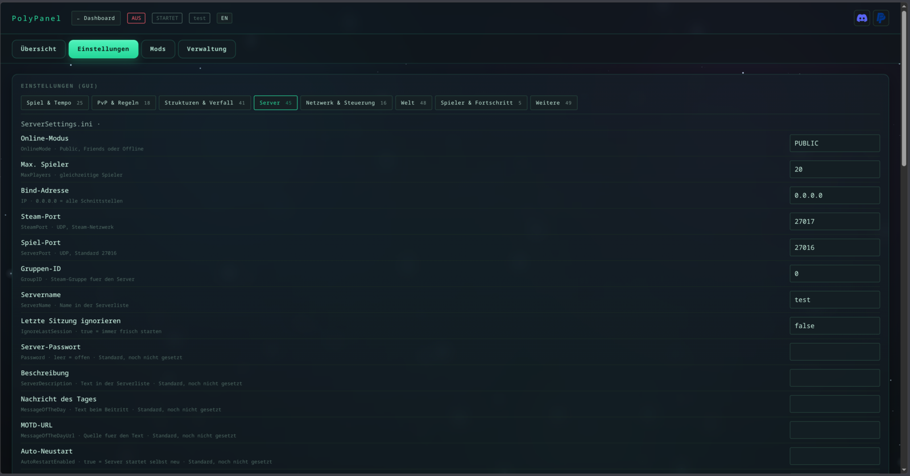
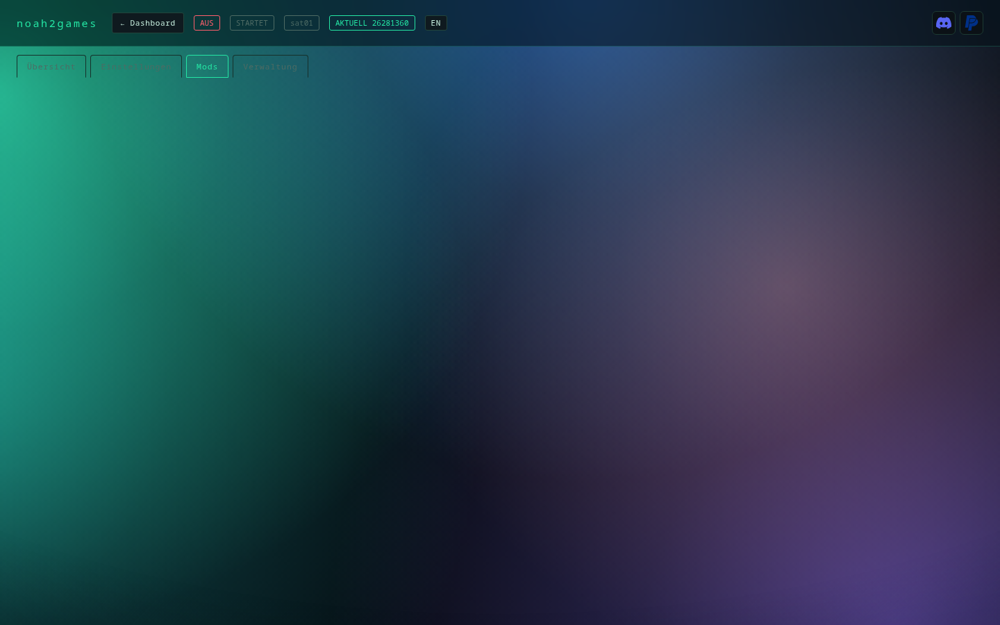
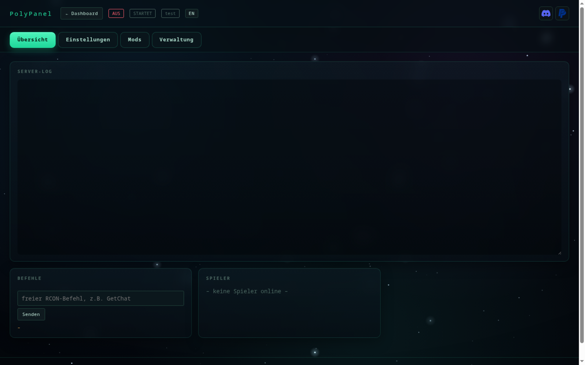
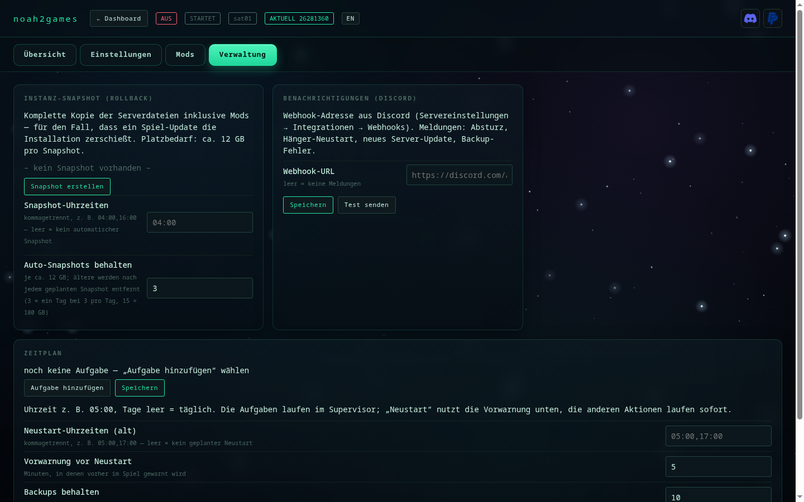

# Funktionen

Was noah2games kann: Überblick, Screenshots, Mod-Verwaltung und Benachrichtigungen.

[← zurück zum README](../README.de.md) · [English](funktionen.md)

## Was es kann

| Bereich | Funktion |
|---|---|
| **Instanzen** | beliebig viele Server, eigenes Verzeichnis, automatische Portvergabe, anlegen und löschen |
| **Steuerung** | Start · Stop · Restart · Update (inkl. Build-Prüfung) und Löschen direkt auf der Dashboard-Karte; die Instanzseite zeigt Server-Log, Befehle und Spieler |
| **Konsole** | RCON-Befehle als Klick-Buttons (Save, Broadcast, Dino-Wipe, Zeit, MOTD …) + freies Feld |
| **Spieler** | Liste mit SteamID, Kick, Ban, Unban, Whitelist, Items geben |
| **Mods** | hinzufügen/entfernen, aktiv/inaktiv, Bilder und Beschreibung von CurseForge |
| **Sprache** | Deutsch und Englisch, Wahl beim Installieren oder jederzeit umschaltbar |
| **Einstellungen** | INI-Werte als Formular (Schwierigkeit, Zähm-, XP-, Ernte-Multiplikatoren …) oder roh |
| **Backups** | Welt sichern, einspielen, planen, aufräumen — mit SaveWorld vor dem Packen |
| **Snapshots** | vollständige Instanz-Kopie für Rollback nach einem kaputten Update |
| **Zeitplan** | Neustarts mit Countdown-Broadcast, automatische Backups |
| **Überwachung** | CPU, RAM (Ist-Wert und Spitze), Spieler, Laufzeit pro Instanz, Auto-Restart nach Absturz |
| **Betrieb** | systemd-Dienst, mehrere Instanzen in einem Prozess; der Überwachungsdienst wird beim Installieren einer Instanz automatisch eingerichtet (als root ein Systemdienst) |

## Einblicke

| Einstellungen als Formular | Mod-Verwaltung mit Bildern |
|---|---|
|  |  |

| Server-Log, Befehle und Spieler | Backups, Snapshots und Zeitplan |
|---|---|
|  |  |

## Mods suchen

Im Reiter **Mods** gibt es ein Suchfeld. Drei Eingaben funktionieren:

| Eingabe | Beispiel | Was passiert |
|---|---|---|
| **Mod-ID** | `947033` | wird direkt übernommen |
| **CurseForge-Link** | `https://www.curseforge.com/ark-survival-ascended/mods/spyglass` | Mod wird aufgelöst, mit Titel und Bild angezeigt |
| **Suchbegriff** | `spy` | **Vorschläge erscheinen beim Tippen** — Bild, ID, Downloads; Klick übernimmt die Mod |

Für die **Namenssuche** braucht noah2games einen kostenlosen CurseForge-API-Key (Feld darunter,
[console.curseforge.com](https://console.curseforge.com) → API Keys). Ohne Key ist die Suche
unzuverlässig, weil CurseForge automatisierte Anfragen blockt — ID und Link funktionieren aber immer.

## Mod-Updates im Blick

Im Reiter **Mods** steht bei jedem Mod, ob die installierte Datei noch die neueste ist. noah2games
vergleicht den installierten Ordner (`<modid>_<fileid>`) mit der aktuellsten Datei auf CurseForge
und zeigt bei Abweichung ein **UPDATE**-Kennzeichen samt „neu seit X Tagen". Damit sieht man sofort,
welcher Modder noch nicht nachgeliefert hat — ohne jede Mod-Seite einzeln zu öffnen.

## Benachrichtigungen (Discord)

Im Reiter **Verwaltung** trägt man eine Webhook-Adresse aus Discord ein
(Servereinstellungen → Integrationen → Webhooks). Dann meldet sich noah2games im Channel, wenn etwas
passiert, das man wissen muss:

| Ereignis | Wann |
|---|---|
| **Server abgestürzt** | Prozess ist ohne Abschied verschwunden — mit den letzten Logzeilen |
| **Server hängt** | Prozess läuft, Spielport bleibt aber länger als `hang_seconds` zu |
| **Server-Update verfügbar** | alle 6 Stunden Prüfung, einmal pro neuem Build |
| **Backup fehlgeschlagen** | statt still zu scheitern |
| **Neustart ausgeführt** | nach einem geplanten Neustart |
| **Server gestoppt** | wenn du ihn selbst gestoppt hast (der Supervisor lässt ihn dann aus) |

Routine wie „Server gestartet" landet nur im Log (`<instanz>/.noah2games-notify.log`), damit der Channel
nicht zumüllt. **Test senden** prüft den Webhook sofort.

Wichtig: ein **manueller Stop** wird respektiert — der Supervisor startet den Server danach nicht
wieder hoch, bis du ihn von Hand oder per Zeitplan startest.

## Instanz entfernen

Auf der Dashboard-Karte steht **Löschen**. Der Ablauf fragt zweimal:

1. „Instanz entfernen?" — der Eintrag wandert nach `~/.config/noah2games/.trash/`, die Serverdateien bleiben liegen.
2. „Auch die Serverdateien löschen (X GB)?" — nur wenn du das bestätigst, wird das Serververzeichnis
   entfernt. Abbrechen lässt die 12 GB unangetastet.

Läuft der Server noch, wird er vorher sauber gestoppt (SaveWorld → DoExit). Gelöscht wird nur ein
Verzeichnis, das wie ein Serverordner heißt (`arkserver…`) — ein falsch gesetzter Pfad kann so nicht
deine Daten treffen.

## Was noah2games für dich übernimmt

Einige Spiele bringen keinen Linux-Server mit (ARK: Survival Ascended, Space Engineers). Damit sie
unter Linux zuverlässig laufen, sind ein paar Kniffe nötig — noah2games macht das automatisch, du
musst davon nichts wissen:

- **Der Server wird immer sauber beendet.** Vor jedem Stopp wird die Welt gespeichert. Einfach
  „abwürgen" würde den Fortschritt seit dem letzten Autosave kosten — das passiert hier nicht.
- **Kein zusätzliches Fenster.** Normalerweise öffnet sich beim Start ein schwarzes
  Windows-Fenster mit Technik-Meldungen. Der Server läuft bei noah2games komplett im Hintergrund.
- **Einstellungen bleiben erhalten.** Das Admin-Passwort und die Admin-Schnittstelle überleben
  einen Neustart — bei einem manuell gestarteten Server überschreibt ARK diese Werte sonst.
- **Befehle kommen an.** Alles, was du in der Weboberfläche schickst (Nachrichten, Dino-Wipe,
  Spieler kicken), läuft über die offizielle Admin-Schnittstelle des Spiels.
- **Der Anti-Cheat-Dienst bleibt aus.** Er blockiert unter Linux den Start; noah2games startet den
  Server deshalb ohne ihn — auf einem eigenen Server ist das der übliche Weg.

