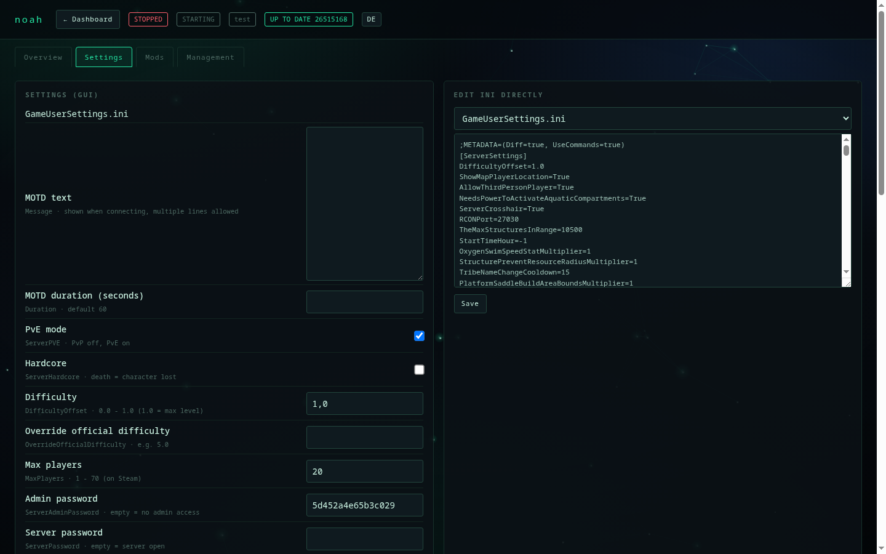
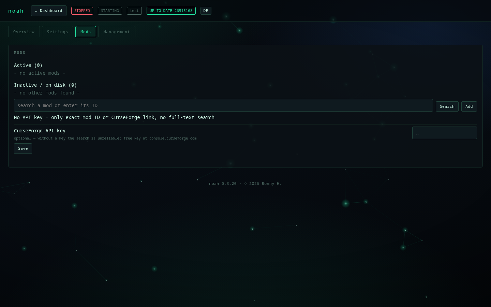
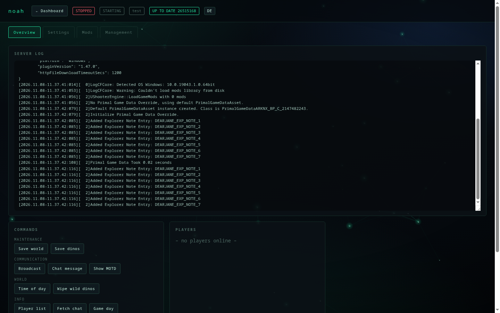
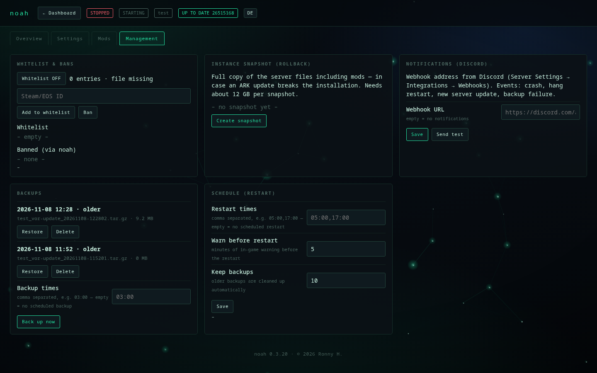

# Features

What noah2games does: overview, screenshots, mod management and notifications.

[← back to the README](../README.md) · [Deutsch](funktionen.de.md)

## What it does

| Area | Feature |
|---|---|
| **Instances** | any number of servers, own directory, automatic port picking, create and delete |
| **Control** | start · stop · restart · update (with build check) and delete right on the dashboard card; the instance page shows server log, commands and players |
| **Console** | RCON commands as one-click buttons (save, broadcast, dino wipe, time, MOTD …) plus a free input |
| **Players** | list with SteamID, kick, ban, unban, whitelist, give items |
| **Mods** | add/remove, active/inactive, images and descriptions from CurseForge |
| **Language** | German and English, chosen at install time or switched any time |
| **Settings** | INI values as a form (difficulty, taming, XP, harvest multipliers …) or raw |
| **Backups** | save the world, restore, schedule, prune — with SaveWorld before packing |
| **Snapshots** | full instance copy for a rollback after a broken update |
| **Schedule** | restarts with countdown broadcast, automatic backups |
| **Monitoring** | CPU, RAM (current and peak), players, uptime per instance, auto-restart after a crash |
| **Operation** | systemd service, several instances in one process; the supervisor is set up automatically when you install an instance (a system service as root) |

## Screenshots

| Settings as a form | Mod management with images |
|---|---|
|  |  |

| Server log, commands and players | Backups, snapshots and schedule |
|---|---|
|  |  |

## Searching for mods

The **Mods** tab has a search field. Three kinds of input work:

| Input | Example | What happens |
|---|---|---|
| **Mod ID** | `947033` | taken over directly |
| **CurseForge link** | `https://www.curseforge.com/ark-survival-ascended/mods/spyglass` | the mod is resolved, shown with title and image |
| **Search term** | `spy` | **suggestions appear while you type** — image, ID, downloads; click to add |

For **searching by name** noah2games needs a free CurseForge API key (field below,
[console.curseforge.com](https://console.curseforge.com) → API keys). Without a key the search is
unreliable because CurseForge blocks automated requests — IDs and links always work.

## Mod updates at a glance

The **Mods** tab shows for every mod whether the installed file is still the newest. noah2games compares the
installed folder (`<modid>_<fileid>`) with the latest file on CurseForge and shows an **UPDATE** marker
plus "new for X days" when they differ. You see at once which modder has not shipped yet — without
opening every mod page.

## Notifications (Discord)

In the **Management** tab you paste a Discord webhook URL (server settings → integrations → webhooks).
noah2games then reports to that channel when something happens that you need to know:

| Event | When |
|---|---|
| **Server crashed** | the process vanished without saying goodbye — with the last log lines |
| **Server hanging** | process runs, but the game port stays closed longer than `hang_seconds` |
| **Server update available** | checked every 6 hours, once per new build |
| **Backup failed** | instead of failing silently |
| **Restart executed** | after a scheduled restart |
| **Server stopped** | when you stopped it yourself (the supervisor then leaves it off) |

Routine like "server started" only goes to the log (`<instance>/.noah2games-notify.log`) so the channel does
not fill up. **Send test** checks the webhook immediately.

Important: a **manual stop** is respected — the supervisor will not start the server again until you
start it by hand or via the schedule.

## Removing an instance

The dashboard card has **Delete**. The flow asks twice:

1. "Remove the instance?" — the entry moves to `~/.config/noah2games/.trash/`, the server files stay.
2. "Delete the server files too (X GB)?" — only if you confirm is the server directory removed.
   Cancelling leaves the 12 GB untouched.

If the server is still running it is stopped first (SaveWorld → DoExit). Only a directory named like a
server folder (`arkserver…`) is ever deleted — a wrong path cannot hit your data.

## What noah2games handles for you

ARK servers are Windows programs. To run them reliably on Linux a few tricks are needed — noah2games does that
automatically, you do not have to know about it:

- **The server is always shut down cleanly.** The world is saved before every stop. Just cutting power
  would cost everything since the last autosave — that does not happen here.
- **No extra window.** Normally a black Windows console pops up with technical messages. Under noah2games the
  server runs fully in the background.
- **Settings survive.** The admin password and the admin interface survive a restart — with a manually
  started server ARK overwrites those values.
- **Commands arrive.** Everything you send from the UI (messages, dino wipe, kicking players) goes through
  the game's official admin interface.
- **The anti-cheat service stays off.** It blocks startup on Linux, so noah2games starts the server without it —
  the usual way on your own server.
